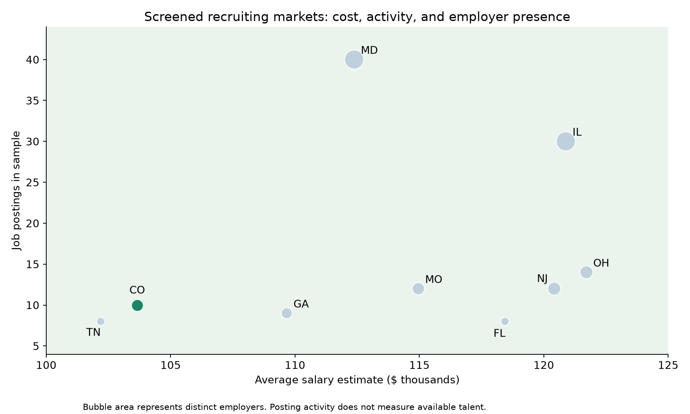
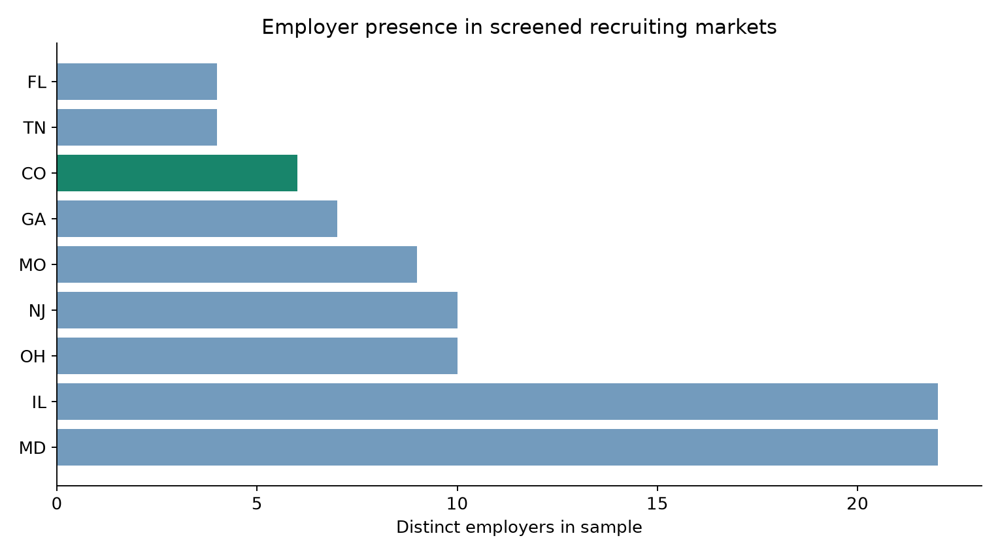

# Where should a startup recruit its data-science team?

**Academic business case:** a hypothetical AI gaming startup needs a recruiting market that balances salary costs, job-market activity, and employer competition.

**Team:** Kaia Hampton, Vincent Guerrero, and Matias Freer. **My contribution:** data cleaning and visualization. The final location recommendation is a team finding.

## Question and approach

I worked on cleaning job-posting data so the team could compare markets consistently. The original workflow addresses missing-value sentinels, salary estimates stored as text, location formats, employer names with appended ratings, and job-title variants.

The portfolio edition reads the supplied **672-row raw CSV**, derives numerical salary bounds and midpoint estimates, standardizes state locations and employer names, and checks salary and geographic validity. It retains original job titles rather than collapsing specializations. Salary midpoints describe posting estimates, not actual employee compensation.

The case-study screen requires **8–40 postings and average estimated salary below $125,000**. The analysis then compares distinct employer counts as a proxy for competition.

## Results

| Colorado measure | Reproduced value |
| --- | ---: |
| Average estimated annual salary | $103,650 |
| Postings | 10 |
| Distinct employers | 6 |

The team selected Colorado as an attractive balance across the criteria. Tennessee and other screened states remain competitive; these measures do not establish a uniquely best location.





## What the visuals communicate

The scatter plot compares cost and activity within the screened population; bubble area represents distinct employers. The employer chart makes the competition proxy easier to compare. Together, they preserve the trade-off instead of collapsing it into an unsupported single score.

## Run and inspect

- [Executed portfolio notebook](analysis.ipynb)
- [Portfolio script](analysis.py)
- [State summary](results/state_summary.csv) and [screened markets](results/screened_states.csv)
- [Original course notebook](original_analysis.ipynb)
- [Original group presentation](presentation.pdf)

Install `../requirements.txt`, put the course file at `data/Uncleaned_DS_jobs.csv`, then run:

```bash
python analysis.py --input data/Uncleaned_DS_jobs.csv
```

## Limits and publication revisions

Postings measure activity in this sample, not available talent. Distinct employers are an imperfect competition proxy, and small state samples make means sensitive to individual listings. Data collection dates and the original dataset version are not fully documented. This is a historical academic case, not a current salary survey.

The portfolio salary parser identifies units before stripping labels and handles irregular locations using the final state token. No hourly records were present, and the rerun reproduces Colorado's figures. See [validation](../VALIDATION.md) and [sources](../DATA-SOURCES.md).
