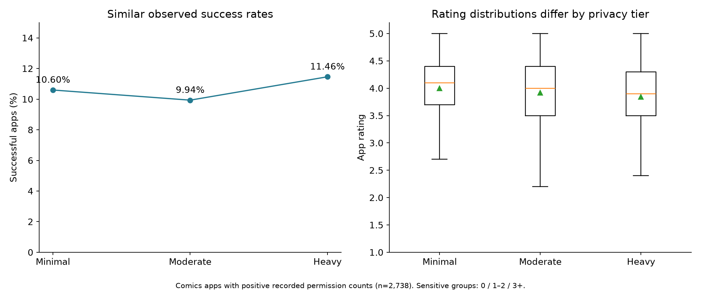
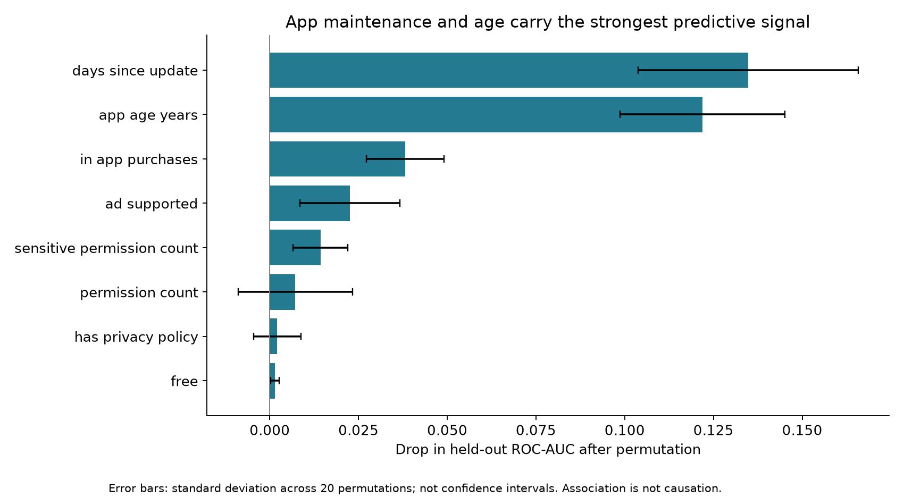
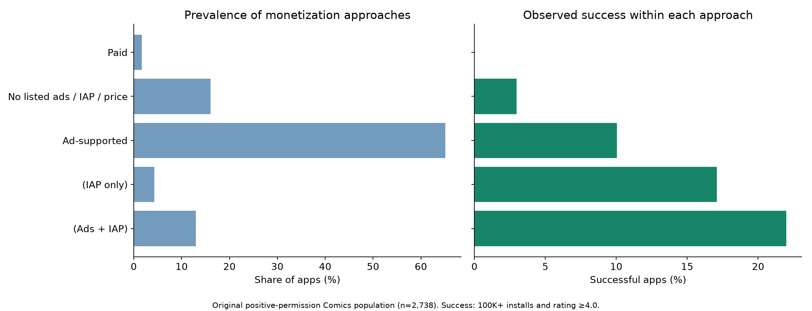

# Can privacy and monetization differentiate a Comics app?

**Academic business case:** evaluate a hypothetical Android startup launch with a $1.5 million budget using Google Play market data.

**Team:** Andrew Bacarella and Matias Freer. **My contribution:** permission-related competitive analysis, Random Forest feature importance, monetization analysis, and visualization. Category selection and the integrated launch strategy are team findings. My analysis started from a joined dataset supplied by the professor; I do not claim the upstream join as my individual work.

## Analysis population and success definition

The cleaned course input contains **2,312,832 app records**, including **2,862 Comics apps**. To reproduce my original comparison, the main analysis uses the **2,738 Comics apps with positive recorded permission counts**. A zero count cannot establish whether a permission record was missing or genuinely empty, so this filter is stated explicitly rather than described as a verified join-match flag.

Success means **at least 100,000 minimum installs and a rating of at least 4.0**. The sensitive-permission tiers are a classroom definition: Minimal = 0 groups, Moderate = 1–2, Heavy = 3+. They are not official platform privacy classifications.

## Does requesting fewer sensitive permissions look advantageous?

| Tier | Apps | Observed success | Mean rating among rated apps |
| --- | ---: | ---: | ---: |
| Minimal | 1,104 | 10.60% | 4.00 |
| Moderate | 936 | 9.94% | 3.92 |
| Heavy | 698 | 11.46% | 3.84 |

Observed success rates are close, while ratings differ across groups. The rating Kruskal-Wallis test gives **p = 0.0000791**; Bonferroni-adjusted pairwise Mann-Whitney tests distinguish Minimal from both other tiers, but not Moderate from Heavy. These tests compare distributions, and statistical significance does not measure business impact or demonstrate causation. Similar success percentages alone do not establish statistical equivalence.



## What predicts the defined success label?

I used a Random Forest and held-out permutation importance to compare permission-related signals with app maintenance, age, and monetization features.

The portfolio edition uses 300 trees, balanced class weights, an 80/20 stratified split, and seed 42. Median imputation is fitted only on training data. The held-out **ROC-AUC is 0.795**, compared with 0.791 saved in the original notebook. Permutation importance uses held-out ROC-AUC, 20 repeats, and seed 42. The strongest signals are **days since update and app age**. Importance measures model reliance within this sample, not the effect of changing a feature.



The [full metrics](results/model_metrics.json) include class-level precision and recall; aggregate accuracy would hide the imbalance between successful and unsuccessful apps. This is a retrospective cross-sectional classifier, not a validated pre-launch or future-outcome predictor. No external or prospective test is claimed.

## How should the app monetize?

Within the original 2,738-app comparison population:

- Ads alone account for **65.1%** of apps, with **10.04%** observed success.
- Ads plus in-app purchases account for **13.0%** of apps and **26.9%** of successful apps, with **21.97%** observed success.
- Median minimum installs are **50,000** for ads plus purchases versus **5,000** for ads alone.

The team recommended an ads-plus-purchases model, restrained sensitive permissions, and continued product maintenance. The data supports a hypothesis to test; it does not establish monetization causality or profitability.



[Original-population results](results/monetization_original_population.csv) and an [all-Comics sensitivity comparison](results/monetization_all_comics.csv) are both included. Labels such as “no monetization” mean no listed price, ads, or in-app purchases, not proof of no revenue.

## Run and inspect

- [Executed portfolio notebook](analysis.ipynb) and [script](analysis.py)
- [Original course notebook](original_analysis.ipynb) and [group presentation](presentation.pdf)
- [Privacy summary](results/privacy_summary.csv), [tests](results/statistical_tests.json), and [permutation results](results/permutation_importance.csv)

Install `../requirements.txt`, place the supplied cleaned course input at `data/Andrew_Clean_Dataset.csv`, then run:

```bash
python analysis.py --input data/Andrew_Clean_Dataset.csv
```

The script reads the large CSV in chunks, selects Comics rows, validates app IDs and success labels, and avoids ambiguous duplicated permission-flag columns. The raw data is not included in GitHub.

## Limits and portfolio revisions

The underlying app scrape is from June 2021. There are no revenue, retention, acquisition-cost, or experimentation outcomes. Snapshot associations can reflect selection, survivor bias, app maturity, and confounding.

The deck's overall permission-match counts do not reconcile with the supplied cleaned input and are not presented here as verified. Publication revisions move imputation into a training pipeline, derive all chart values from calculated tables, retain negative permutation values, and add repeat-variation bars. Original code and results remain in the course notebook; [validation](../VALIDATION.md) documents differences and [sources](../DATA-SOURCES.md) describes access.
