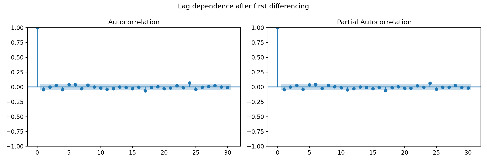
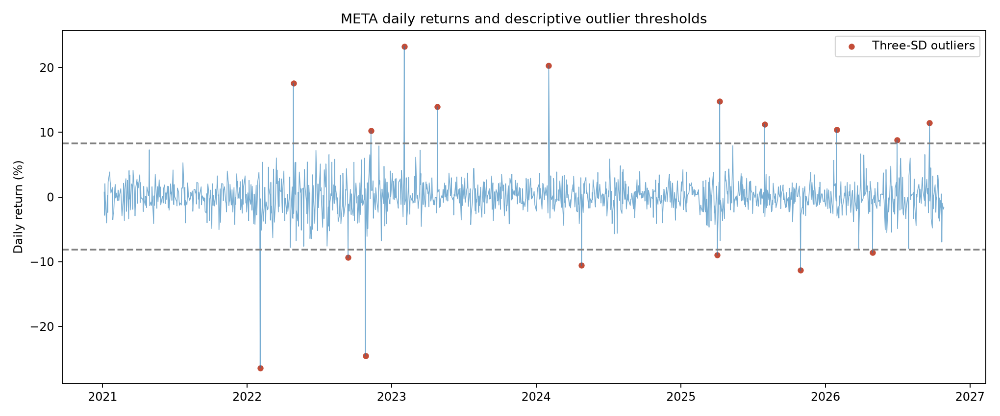
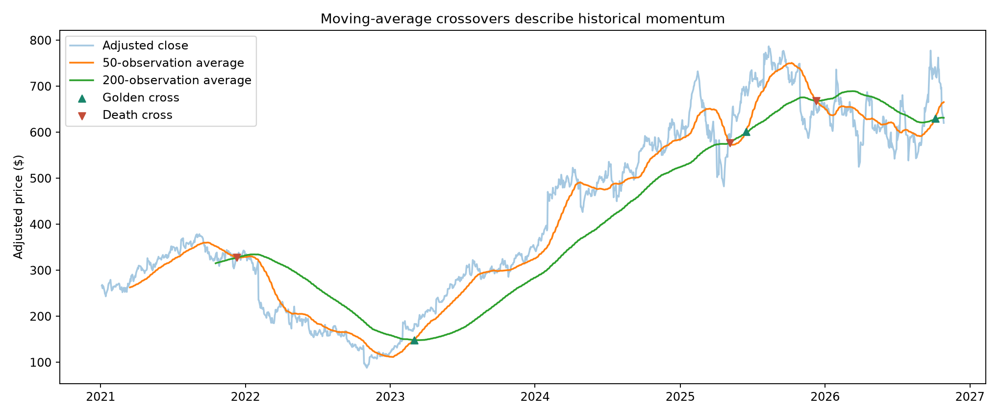

# META: stationarity, volatility, and trend signals

**Academic group project:** examine META stock prices using time-series diagnostics and visual analysis.

**Team:** Sarah Bottom, Vincent Guerrero, and Matias Freer. **My contribution:** stationarity testing, ACF/PACF and initial ARIMA setup, volatility and outliers, moving averages and trend signals, and visualization. The broader team's forecasting comparison, market-event narrative, and financial analysis are not claimed as my individual implementation.

## Questions and workflow

I tested whether price levels were stationary, examined whether first differencing changed the conclusion, inspected ACF/PACF lag structure, and used returns and moving averages to describe unusual moves and historical momentum.

The portfolio edition downloads Yahoo Finance data through `yfinance` with explicit adjusted-price settings and fixed dates. This rerun contains **1,461 observations from 2021-01-04 through 2026-10-27**. End date 2026-10-28 is exclusive.

## Results of the fixed-date portfolio rerun

| Measure | Result |
| --- | ---: |
| Raw-price ADF p-value | 0.77124 |
| First-difference ADF p-value | Below displayed numerical precision |
| Mean daily return | 0.096% |
| Daily-return standard deviation | 2.740% |
| Three-SD outlier days | 17 |
| Golden / Death Crosses | 3 / 3 |

At a 5% threshold, the raw-price test fails to reject the unit-root null; the first-difference test rejects it. This motivates d=1 as an initial ARIMA setup. ACF/PACF diagnostics guide candidate models but do not establish a best forecast model.



The return chart marks observations outside the sample mean plus or minus three standard deviations. This is a descriptive screen, not an assumption that returns are normally distributed.



Crossovers use 50- and 200-trading-observation averages. They describe changes in historical momentum and do not guarantee subsequent returns.



## Original course work versus portfolio rerun

The original saved notebook reports raw-price ADF p=0.87018; the deck displays 0.8707. The fresh fixed-date run gives 0.77124; all reach the same raw-price test conclusion at 5%. Original outputs also show 17 outliers and three crossovers in each direction. The original complete price snapshot was not supplied, so exact numerical reproduction is not claimed.

The portfolio edition removes the original repeated download overwrite, specifies adjustment settings, and saves a local snapshot and retrieval metadata. Historical prices may be restated by the provider. The two result sets are labeled separately.

## Run and inspect

- [Executed portfolio notebook](analysis.ipynb) and [script](analysis.py)
- [Metrics](results/metrics.json), [outliers](results/outliers.csv), and [retrieval metadata](results/data_provenance.json)
- [Original course notebook with saved outputs](original_analysis.ipynb)
- [Original group presentation](presentation.pdf)

Install `../requirements.txt`, then from this folder:

```bash
python analysis.py --download --start 2021-01-01 --end 2026-10-28
```

This downloads an adjusted-price snapshot to `data/meta_prices.csv`. Later reruns can use the saved CSV:

```bash
python analysis.py --input data/meta_prices.csv
```

## Limits

The original group presentation includes SARIMAX versus AR(30) and forecast-error figures. Their team implementation was not supplied, so they are retained only as original presentation content and are not independently verified here. This project page focuses on my documented contribution.

Neither stationarity diagnostics nor crossover plots establish predictive profitability. Returns have heavy tails, sampling and adjustment choices matter, and new business events can change market behavior. This is an academic analysis, not an investment recommendation. See [validation](../VALIDATION.md) and [sources](../DATA-SOURCES.md).
